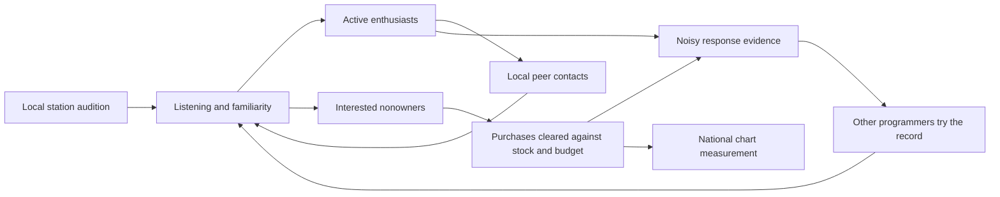

# What the local radio pipeline is missing

Investigation started 2026-10-29. This is an economic-model investigation with fresh live experiments, not a replay study or a proposed default calibration. Existing uncommitted work was retained. Earlier handoffs supply evidence and hypotheses; the current request controls the investigation. In particular, indie-oriented tastemakers remain in the principal experimental control.

## Diagnosis

The missing object is **a local population of listeners who hear, respond to, share, and eventually buy a particular record**. The existing model has awareness, commercial response, station lists, inventory, artist fans, and a finite purchase budget. Those are useful components. It does not yet connect them through a title-specific local adoption process.

Much of its strongest positive feedback is instead attached to national chart position. This makes national success help cause itself, while an early local DJ audition has little consumer effect. Selecting the right records more accurately cannot by itself repair that asymmetry.

This does not require changing a song's quality or letting a DJ magically improve its latent appeal. Persistent taste can remain fixed. What should emerge is how many people encounter the record, how listening changes their readiness to buy, and whether their response encourages other listeners and programmers to take it up.

## The actual causal path

The weekly engine updates national heat/awareness, computes demand and clears purchases, observes local sales, holds station meetings, updates regional radio/awareness, and schedules regional exposure. An add at this week's meeting therefore reaches purchase demand next week. That lag is sensible and is preserved in the experiments.

### 1. The hearing-to-purchase connection is extremely attenuated

In `ChartManager.UpdateRegionalData`, regional awareness loses 8%, then gains `0.12 × regional radio`. The study profile blends only 8.5% of the explicit station panel into regional radio. Demand then blends 60% regional awareness and 40% national awareness, unless another gate/floor overrides it.

Ignoring carryover and nonlinear odds for illustration, the direct next-week contribution of panel rotation is:

```
effective awareness contribution = 0.60 × 0.12 × 0.085 × panel rotation
                                 = 0.00612 × panel rotation
```

A Light add at one station with a tenth of the regional panel's reach gives rotation `0.2 × 0.1 = 0.02`, or just **0.01224 percentage points** of effective awareness. This is the positive panel contribution, not the net difference against removing the entire blend: the blend also replaces some tail radio. Carryover can accumulate it, and chart effects are another route, so it is not a complete causal-effect estimate.

In the fresh 12-week control, 3,598 uncharted record-region-week observations have some prior-week panel support. Their median panel rotation is 0.00861 and their median aware fraction is 0.1964. These are all supported observations, not an identified sample of discretionary picks. They illustrate the scale of the signal reaching the consumer path.

The staged demand function also reads **national `radioHeat`**, not local station rotation, in its radio discovery signal. That signal enters a geometric mean with chart and momentum signals; the geometric mean intentionally avoids triple-counting correlated discovery, but it cannot substitute for a missing local listening process.

There is also a split in the radio state: individual stations now have cooldown-limited re-adds, while the aggregate `stationsDropped` latch remains permanent. A returning explicit station contributes through the small reporter component, but does not reopen the broad regional tail. In existing seed-1001 `pp`, 252 of 16,454 listed record-weeks have `radioPanelShare == 0` (all weighted aggregate regions dropped). This is evidence that the two representations can disagree, not proof that every such week is an erroneous re-add. Keep station-level resistance to churn; reconcile the underlying listening audience rather than merely removing every anti-oscillation rule.

### 2. National success already owns several amplifiers

`ChartSimulator.CalculateRegionalSales` supplies awareness floors of 0.4 for national Top 40 and 0.7 for Top 10, plus a rank-dependent purchase-exposure curve. National chart position also contributes to national awareness and word of mouth, and affects campaign continuation. The late-region relive mechanism replays earlier national awareness/rank rather than modelling that region's own accumulating experience.

There are sensible real mechanisms behind parts of this: charts affect displays, trade attention and distribution. But an empirical rank-sales curve is an outcome relationship, not an estimate of the causal effect of printing a chart position. Using it as a demand input can reproduce a sales distribution while pre-empting the local mechanism we want to emerge.

A full-year diagnostic of the existing `djb24u-lr05t`, seed 1001, gives median awareness 0.253 off-chart versus 0.700 in the Top 10. Median intrinsic conversion is 0.00114 off-chart versus 0.101 at positions 6–10 and 0.130 at 1–5. **These are selected groups, not causal ratios**: successful records also differ in fit, quality, age and supply. The code, rather than these conditional medians, establishes the feedback channels.

### 3. Chart reporting and hearing are conflated

`StationNetwork.ReporterRadioPlay` weights station reach by Hot-100 reporting relevance: Top40 1.0, FullService 0.85, R&B 0.35, MOR 0.25, Country 0.10, Jazz/Gospel 0.05. These weights affect both numerator and denominator. This is a pop-chart panel proxy; it is not a count of people hearing music.

Using that same number for consumer exposure discounts specialist listeners because their stations are weak pop-chart reporters. A listener measure should use actual audience/format/segment reach, with overlap handled separately. The experimental `ListenerRadioPlay` removes reporting weights from the consumer proxy only. It still averages over a macroregion and does not solve audience overlap or segment composition; it is a diagnostic step, not a finished listening model.

### 4. Word of mouth has no title-specific social population

National WOM moves toward a target computed from quality, national chart position and momentum. Regional WOM adds a small awareness increment from sentiment and awareness. Neither represents identifiable recent enthusiasts who expose their friends. A high-quality unplayed record can acquire the quality component of national WOM without a causal chain of hearing and recommending it.

`ArtistFanbase` already does something useful and different: settled purchases recruit attached listeners, and returning fans are depleted as they buy a later release. That should be reused where applicable. It is not a local same-record listening/sharing process, and its existing cohort must not be counted again as a new anonymous audience.

Listening enjoyment and willingness to own the record should also be distinct. A frequently requested record can be a radio success with weak sales. Increasing spins should create listening opportunities, not guarantee a monotonically increasing purchase multiplier for every title. The existing buying-population, format and budget distinctions can remain, while a title's local response governs the conversion from those opportunities to ownership.

### 5. A city's intense response is averaged into a very large region

Cities, distance, station formats and optional city reach already exist. However, the core purchase state and sales reports used here are still macroregional. A concentrated audience in one city or scene can be a substantial fraction of its own peer network while remaining an almost invisible fraction of a seven-region denominator.

This matters mathematically: social spread depends on contacts within a relevant group, not units divided by the entire national or macroregional population. More independent regional noise does not recreate that contact structure. Nor does giving every station in a macroregion the same sales rank with a different noise draw.

### 6. Propagation is gated by a predetermined connection and national proof

`RegionalFitExposure.UpdateWeek` spreads only records whose national commercial draw exceeds the connection threshold. It then uses a local Top-40/neighbour rule or national Top-40 rule. The optional station path changes exposure timing but retains this connection gate.

That makes the draw an advance classification of who can participate in the spread mechanism. Persistent appeal is reasonable; treating it as a hard permission to diffuse is a stronger assumption. A genuinely strong local response should be evidence other markets can test, including when a national prior was poor. They can then reject it. This does not mean all local hits should become national hits.

The keyed latent draw is persistent. The complete commercial multiplier also includes launch awareness, regional response and hit-act support; in the general implementation its push component can be read from the current owner. The profile used here has no added commercial-fit push weight. “Fixed appeal” should not be confused with “every component of effective demand is immutable.”

### 7. Buying is finite; stronger enthusiasm mostly reallocates sales

In the existing full-year seed-1001 diagnostic, raw single demand is 425.5 million, serviceable intent 397.3 million and cleared single purchases 121.2 million. The median inventory-fulfilment ratio for off-chart observations is about 0.991, whereas the median market-fulfilment ratio is about 0.310. These are conditional per-observation medians; the aggregate sums are the appropriate volume accounting.

Thus a blanket boost is mostly a competitive reallocation. It can make a few records larger by starving others, changing label income, release decisions and later careers. Early weeks can still fill unused purchasing capacity, so aggregate purchases are not exactly fixed in every short run.

The broad anonymous demand pool also lacks the exact title-ownership depletion already implemented for returning fans. Its saturation term is soft and its lifecycle also uses age/peak decay. A credible local cascade should use a finite pool and actual settled purchases for depletion. Otherwise stronger diffusion is liable to require yet another arbitrary decay correction.

## What the historical evidence supports

Paul Hirsch's contemporary field study describes breakout stations/markets, promotion of observed local successes to more cautious programmers, and crossover from specialist audiences into Top 40. It also distinguishes listener requests from purchases, including records listeners request but do not buy. This supports separate listening, response, purchase, and programmer-information channels. It does not identify the numerical parameters for a 1960 simulation, and much of the cited field material is from later in the decade. [Hirsch, *The Structure of the Popular Music Industry*, especially printed pp. 50–52 and 68](https://cdn.isr.umich.edu/pubFiles/historicPublications/Structure_2913_.PDF).

Controlled MusicLab experiments show that social information can increase the inequality and unpredictability of musical success while underlying appeal still matters. They support endogenous cumulative advantage with persistent tastes. They used online listening/free downloads, not 1960 paid records, so they cannot supply purchase rates or radio coefficients. [Salganik and Watts, 2009](https://www.princeton.edu/~mjs3/salganik_watts09.pdf); [Salganik and Watts, experimental popularity intervention](https://pmc.ncbi.nlm.nih.gov/articles/PMC3785310/).

Bass's 1969 adoption model supplies a useful mathematical precedent: adoption timing depends on external contact and previous adoption. Its empirical application was consumer durables, not competing singles. A single-product Bass curve pasted onto every record would ignore shared attention, overlapping listeners and the common purse. Use the bounded hazard and finite population idea, not its fitted coefficients. [Bass, 1969](https://pubsonline.informs.org/doi/pdf/10.1287/mnsc.15.5.215).

## Live experiment design

The experiment runner starts fresh worlds, retains the existing regional-fit research profile at launch weight 0.25, and preserves inventory, common-market clearing, finance, label behaviour and the fixed latent fit draws. Its main control is the prior no-trial DJ-ear pick policy with **tastemaker-indie enabled and the local-rank pick bonus omitted**. Separate short controls reproduce plain picks and no picks. This distinguishes a historically motivated tastemaker preference from the previous local-sales selection experiment.

Every run records full arguments, assembly hash, exit/completion receipt and elapsed time. The 26-week-and-later batches also snapshot the research sources; the 12-week batch retains its assembly. Probes do not use replay scores or future peaks as inputs. They read the preceding station meeting and completed purchases before the current sales pass. Changes can alter later RNG consumption and release identities, so matching `gen_N` across divergent worlds is not a valid same-record causal comparison. Comparisons are paired at seed level.

The source probe is explicitly fresh-world-only: its listening memory is session state and save/resume runs are rejected. It is a disposable mechanism screen, not a save-compatible implementation. No production defaults are changed.

For the probes, let `a` be the original aware share, `r` preceding panel rotation, `y` preceding cleared local purchases, `N` potential buyers, and `m` listening memory:

```
m(t) = 0.7 m(t-1) + r(t-1)
contact = 1 - exp(-c r)
peerContact = 1 - exp(-b y / (0.01 N))
a' = a + (1-a) [1 - (1-contact)(1-peerContact)]
raw demand = N a' × existing conversion × [1 + f (1-exp(-m))]
```

These are separate ablations: direct contacts (`c`), buyer-driven WOM (`b`), and repeated-listening conversion (`f`). The arbitrary 1% peer denominator and 0.7 memory retention are **screening assumptions**, not measured historical facts. Contact/WOM increments are bounded by the remaining unaware share. The familiarity multiplier is bounded by `1+f`; it is deliberately a stress test and does not implement exact buyer depletion. Existing fanbase partitioning and supply/budget clearing follow the probe.

The dedicated `local-consumption.csv` records both sides of this added demand step. The older demand-stage awareness/conversion fields remain the **pre-probe** decomposition; they must not alone be used to reconstruct treated demand. `rawAfter` is the input to the subsequent existing fanbase partition. This is another reason to retain these switches as research probes rather than adopt them as a finished consumer implementation.

Other arms substitute a local radio discovery signal, let local sales rank earn shelf exposure up to the existing national curve, remove national awareness floors, or remove both floors and the national awareness blend. These identify dependencies; they are not all sensible production policies.

The 12-week screen follows weeks 3–5 releases for eight weeks and is used for gross mechanism rejection only. The 26-week screen follows weeks 5–15 releases for 12 weeks. Full-year screens follow weeks 5–38 for 12 weeks. Run coverage, rather than title survival, determines eligibility; retired failures remain failures. Both the complete LA/Minneapolis station panel and the fixed two-LA/one-Minneapolis panel are retained. “Uncharted” always means within the specified horizon.

For continuity with the prior benchmark scripts, “indie Top 10” here means **not owned by the Big Five label IDs**, not exclusively the `Independent` label tier. The tastemaker policy excludes all `Major` tier labels, a different classification. Unit shares by actual tier are reported separately. Sales-size quantiles/counts use exported record histories and can omit units in a retirement week; aggregate purchase totals use the complete clearing ledger.

### First screen: 14 fresh 12-week worlds, seed 1001

Completed batch: `SimLogs/lrc12-v2`. Initial sandbox attempts (`lrc12-v1`) never initialized the simulation and are excluded. The successful runs took roughly 72–84 seconds each, three concurrent processes. No captured-meeting replay supplied any outcome.

The control sells 22.758M singles on 39.475M raw single demand. Its ten largest weekly sellers take 39.37% of exported single units. Changes below compare the full 12-week windows, including opening catalogue; they are not isolated effects on new releases.

| Arm | Raw single demand | Single purchases | Ten-largest-sellers unit share |
|---|---:|---:|---:|
| Plain picks, no tastemaker restriction | +0.1% | −0.0% | −0.0 pp |
| No picks | −5.7% | +1.3% | −0.1 pp |
| Direct contacts, c=1 | +7.4% | +1.8% | +2.3 pp |
| Direct contacts, c=3 | +21.3% | +3.3% | +2.9 pp |
| Familiarity conversion, f=2 | +54.5% | +2.9% | +9.2 pp |
| Familiarity conversion, f=6 | +155.1% | +4.8% | +12.6 pp |
| Buyer WOM, b=2 | +35.0% | +3.5% | +1.2 pp |
| Buyer WOM, b=8 | +48.7% | +5.2% | −1.1 pp |
| Local sales earn shelf exposure | +6.4% | +1.0% | −0.8 pp |
| Local radio replaces national discovery signal | −0.1% | +0.2% | +0.2 pp |
| Remove national awareness floors | −16.3% | −3.7% | −5.5 pp |
| Regional awareness only, no floors | −40.6% | −21.2% | −2.8 pp |
| Contacts + familiarity + WOM (1,2,2) | +120.2% | +6.2% | +8.7 pp |

The useful rejection is the familiarity **conversion multiplier**, not the concept of repeated listening: this implementation strongly amplifies existing winners and creates excessive competing intent. The combination inherits that defect. The pure local-radio discovery substitution is very weak. Removing national supports without replacing their job damages purchasing. Contacts, buyer WOM and local retail proof merit longer tests; the listener-weight variant tests a separate measurement problem.

Only 62–63 releases qualify for the short early cohort, with 1–3 indie Top-10 outcomes depending on arm. A displayed 33% lead can mean one record. No lead-rate ordering from this screen was treated as established.

Validation checked 429,366 probe rows, bounded awareness and demand response, zero-source identity, and every exported market's inventory/allocation/reconciliation/settlement counters: zero violations. With probes inactive, all 8,073 record rows, 31,646 playlist rows and 7,156 finance rows from the plain-picks run exactly match the first 12 weeks of the prior full-year `pp` run when parsed as CSV strings. The observer therefore does not change the economic trajectory in that control. The native playlist/exposure checks and the two existing pipeline-scoring tests also pass.

### Second screen: 12 fresh 26-week worlds, seeds 1001–1002

Completed batch: `SimLogs/lrc26-v1`. Equal-weight seed means below; these are exploratory means of **two** worlds per arm, not precise parameter estimates. Every arm has roughly 1,000 qualifying releases per seed and a 12-week outcome horizon. Brackets show the fixed 2+1 station panel; the main figures use all eligible LA/Minneapolis stations.

| Arm | Single purchases, M | Raw single demand, M | Big-5 Top-10 slots | Ten-largest-sellers unit share | Closures | Indie Top-10 lead ≥2 | Peak 41–100 lead ≥2 |
|---|---:|---:|---:|---:|---:|---:|---:|
| Control | 57.27 | 162.45 | 39.42% | 32.99% | 11.5 | 16.67% [6.67] | 32.26% [23.97] |
| Contacts c=3, reporting-weight proxy | 58.14 | 207.40 | 34.04% | 34.62% | 14.5 | 18.22% [13.66] | 26.97% [15.10] |
| Contacts c=3, listener-weight proxy | 58.12 | 196.27 | 37.69% | 34.32% | 14.0 | 32.46% [18.71] | 30.17% [20.61] |
| Buyer WOM b=2 | 58.23 | 241.57 | 36.35% | 31.41% | 13.5 | 19.44% [12.04] | 29.02% [15.61] |
| Buyer WOM b=8 | 58.70 | 283.73 | 39.23% | 29.39% | 13.0 | 20.06% [8.79] | 28.60% [14.47] |
| Local shelf | 57.56 | 175.68 | 36.73% | 31.27% | 12.0 | 12.55% [12.55] | 29.07% [17.94] |

The control's indie lead is 1/15 on seed 1001 and 4/15 on seed 1002. The listener arm gives 6/18 and 6/19. The consistency of the treatment levels is encouraging, but the paired improvements differ greatly because the controls differ. The fixed panel reduces the apparent gain substantially. This is why the best short-window percentage is not an adoption decision.

The listener arm also increases the number of releases reaching 250,000 exported units in 12 weeks from a mean 23.5 to 31.5, while releases below 2,000 rise from 38.43% to 43.41%. That is economically meaningful redistribution, not a free improvement. It raises closures by 2.5 on average. Genre unit-share changes include Traditional Pop +2.09 points, Teen Pop −1.87 and Easy Listening −1.72; the route is not genre-neutral.

The strongest buyer-WOM arm produces more Top-10 records (22.5 versus 15 per seed in the launch cohort), but **no** million-copy records within the 12-week horizon, versus a mean one in control. The ten largest sellers lose 3.60 points of unit share. This particular bounded-awareness WOM formula broadens mid-sized success rather than concentrating the largest phenomena. That does not reject social diffusion generally: it tests a weekly purchase-driven awareness increment, without an enduring stock of non-buying advocates or exact title-owner depletion.

Both the listener arm and strong WOM advance to fresh full-year tests because they reveal different mechanisms. Local shelf alone does not consistently improve the desired pathway. All 1,716,379 half-year probe observations and all market integrity counters passed validation.

### Third screen: nine fresh 52-week worlds, seeds 1001–1003

Completed batch: `SimLogs/lrc52-v1`. Results checked on 2026-10-30 against fresh recomputation of the saved CSVs. All 35 planned worlds across the three successful batches have complete, zero-exit receipts with unchanged assembly hashes within each run. No additional simulation worlds were needed to finish this screen.

The table uses equal-weight seed means. Lead outcomes follow weeks 5–38 releases for 12 weeks; brackets retain the fixed 2+1 station panel. Purchases, demand, concentration and closures cover the entire 52-week window, including opening catalogue. Concentration here is the ten largest weekly sellers' share of **exported record units**, as computed by the analyzer; it is not a single-only clearing-ledger share.

| Arm | Single purchases, M | Raw single demand, M | Big-5 Top-10 slots | Ten-largest-sellers unit share | Closures | Indie Top-10 lead ≥2 | Peak 41–100 lead ≥2 |
|---|---:|---:|---:|---:|---:|---:|---:|
| Control | 121.05 | 428.28 | 37.69% | 29.30% | 39.33 | 19.19% [8.24] | 30.55% [20.07] |
| Listener contacts c=3 | 121.88 | 514.99 | 35.19% | 30.52% | 48.67 | 25.63% [17.21] | 30.95% [19.53] |
| Buyer WOM b=8 | 122.49 | 751.27 | 39.04% | 24.99% | 43.00 | 30.38% [19.34] | 31.60% [19.21] |

The listener-contact arm's full-panel indie lead improvement is **+6.45 percentage points**, with paired standard error 8.02 points. Its per-seed lead counts are 18/50, 10/43 and 9/51, against control's 5/37, 10/40 and 8/42. Thus the full-panel rate improves only in seed 1001; the mean does not establish a repeatable improvement. The fixed-panel mean rises 8.97 points (paired SE 5.34). Purchases rise just 0.83M while raw demand rises 86.70M. Closures increase by 9, 15 and 4: **+9.33 on average**. These costs prevent recommending this coefficient as a default even though measuring listener reach separately from chart-reporting relevance remains sound.

Buyer WOM gives 16/59, 18/52 and 15/51 indie lead outcomes. Its full-panel paired gain is **+11.19 points** (SE 1.22), and the fixed-panel gain is +11.10 (SE 2.22). Those directions repeat across these three seeds, but they do not prove that the local adoption mechanism is now correct. Average debut age among eventual indie Top-10 records rises from 2.64 weeks to 3.33, while the fraction listed by age two falls from 64.46% to 46.45%. These are selected, changing hit cohorts, not matched-title timing effects. They show why more room for a lead before national debut must not be mistaken for earlier or more effective local discovery.

The WOM arm adds 322.99M raw demand but only 1.44M purchases. Its ten-largest-sellers share falls 4.32 points. Within the 12-week release horizon, million-copy titles average 0.67 versus 2.00 in control, while the share below 2,000 copies rises from 41.16% to 48.81%. Listener contacts instead average 2.33 million-copy titles, but also raise the below-2,000 share to 45.03%. More medium-sized successes coexist with more weak sellers; neither treatment supplies a general improvement across the size distribution. Closures in the WOM arm change by +5, +8 and −2, so its mean increase of 3.67 is less consistent than the listener arm's damage.

Genre and ownership measures also move differently. Listener contacts increase Traditional Pop's exported unit share by 1.86 points and reduce Doo-Wop by 1.71 and Rock and Roll by 1.63. Their Big-5 chart-slot share falls, but actual Major-tier exported unit share rises from 36.78% to 37.74%. WOM raises Independent-tier unit share from 21.20% to 22.29% while its Big-5 chart-slot share rises. Chart ownership, actual label tier and economic survival must therefore remain separate checks.

### Longer follow-up: 24-week outcomes for weeks 5–26 releases

The saved `SimLogs/lrc52-v1/horizon24` analysis uses the same nine worlds with a narrower launch cohort and a longer follow-up. It is **not additional experimental replication**, and its levels should not be subtracted from the 12-week table as if the title cohorts were identical. Treatment-versus-control comparisons within this contract remain seed-paired.

| Arm | Qualifying releases per seed | ≥250,000 copies | ≥1 million copies | Below 2,000 copies | Indie Top-10 lead ≥2, full [fixed] |
|---|---:|---:|---:|---:|---:|
| Control | 2,042.00 | 59.00 | 3.33 | 27.82% | 22.91% [13.74] |
| Listener contacts c=3 | 2,012.67 | 74.00 | 3.00 | 33.11% | 30.83% [19.29] |
| Buyer WOM b=8 | 2,029.33 | 67.00 | 1.00 | 40.05% | 29.27% [21.40] |

The longer window does not rescue WOM's million-seller deficit: it produces exactly one qualifying million-copy title in each seed, versus control's 3, 2 and 5. Listener contacts produce 4, 2 and 3, so their slight advantage in the broader 12-week cohort does not establish more eventual million sellers. Both arms still increase the fraction of very low-selling releases. These sales counts use exported histories, with the retirement-week limitation described above.

Re-running validation checks all **2,961,035** full-year probe observations: finite telemetry, bounded awareness and demand, zero-source identity, and all exported inventory, allocation, reconciliation and settlement counters pass. Both 12- and 24-week analysis outputs were regenerated independently of the saved tables and compared with them. These checks validate the tested accounting and probe bounds; they do not establish finite title ownership or realistic listener diffusion, which the probes do not implement.

### Decision and the next discriminating experiment

Close this coefficient screen without adopting either treatment as a production default. The completed runs support replacing the missing local listener process, but do not validate a particular replacement. They also **do not test removal of the national connection gate**: all these arms retain it. In the current source, `RegionalFitExposure.UpdateWeek` skips a record failing `SingleCommercialFit.Connected` before considering either local sales or sustained station support. Strong local evidence therefore cannot override that permission rule in these runs.

The next mechanism experiment should distinguish permission to **audition** from successful **acceptance** in the destination market. Preserve persistent taste and the existing economic constraints. Let lagged, exposure-adjusted local response nominate a record for a finite destination station slot without requiring a connected national draw. The destination must then observe its own response and may reject the title. Simply deleting the gate would activate the existing exposure/relive machinery directly and would not test that proposed learning process cleanly.

Use a control and a response-earned-audition arm first, holding consumer coefficients fixed; only then cross that change with a bounded listener-state prototype. Record nominations, available slots, accepted auditions, local exposure, subsequent response, ordinary retention, cleared purchases and destination rejection, including records below the national connection threshold. Count all originating auditions, not only eventual hits. Required outcomes include failed local hits, below-threshold records that earn and survive additional auditions, and national successes that emerge through several observed market responses. A cohort that fails in its next market is a valid outcome. Conservation of listeners/owners and stock/cash remain separate acceptance tests.

That is a proposed next experiment, not a mechanism implemented or validated by the 35 completed worlds.

Follow-up on 2026-10-30: the opt-in recommendation experiment is now implemented
and screened in 12 additional live worlds. See
[`ResponseAuditionInvestigation.md`](ResponseAuditionInvestigation.md) for the
contract and results. Response ranking improves destination trial graduation
and ordinary persistence across three 26-week seeds, but does not increase
below-threshold graduations or establish a national-breakout/economic gain.

## A model that can produce an organic breakout

Use small city/segment cohorts, not individual simulated people. Keep appeal heterogeneous and persistent, but let adoption be endogenous. Four state variables per active title/cohort would be sufficient for a first version:



- `M`: finite potential willing audience, derived from cohort size and persistent taste; shared population, not fresh buyers manufactured per week.
- `C`: aware, interested people who have not bought this title.
- `B`: owners, incremented only by settled purchases and never counted as new buyers of the same title.
- `E`: active listeners/advocates, including listeners who have not bought; enthusiasm decays without reinforcement.

Let `x` be actual listening contacts, `p` direct promotional contacts, and `W` a sparse city/segment contact network. One bounded acquisition rule is:

```
newInterest = (M - B - C) × [1 - exp(-αx - p - β (W E)/N)]
purchaseIntent = (C + newInterest) × [1 - exp(-κ × familiarity)]
actualPurchases = existing stock/access/common-purse clearing(purchaseIntent)
B' = B + actualPurchases
C' = (C + newInterest - actualPurchases) × (1 - interestLoss)
E' = (1 - enthusiasmLoss) E + newEnthusiasts
```

`newEnthusiasts` must come from actual listening/response, be bounded by the remaining non-enthusiast audience, and avoid recruiting the same person twice. The equations for `C` treat lost interest as returning to the uncommitted potential pool; this is an explicit simplification. Ownership never returns there. A production design must also partition the returning fan cohort and apply integer settlement without losing these identities.

For nonnegative contact rates and hazards, `0 ≤ newInterest ≤ M-B-C` and `0 ≤ actualPurchases ≤ purchaseIntent ≤ C+newInterest`. Consequently `B'+C' ≤ M`. This is the useful conservation guarantee: diffusion moves people between states rather than multiplying an unlimited weekly buying pool. Across titles, listening contacts must share a finite station/attention budget, and purchases continue to share the existing purse. A person may own multiple different titles, so per-title ownership bounds do not replace that cross-title budget.

Near the start, the social subsystem has growth approximately proportional to `β × susceptible share − enthusiasmLoss`. In a multigroup model the corresponding condition is a dominant eigenvalue above one for the next-generation contact matrix. This supplies a genuine threshold: most auditions die; some cross a local growth threshold; links between cities and formats determine whether they spread. Saturation, limited listening attention, competing titles, enthusiasm loss, available stock and the purchase purse bound the result. Increasing a coefficient without these bounds is not the same model.

Radio stations should learn from **response relative to exposure**, not only absolute early units or an oracle fit score. A small market selling 500 copies after a small audition is different evidence from 500 copies after blanket promotion. A shrunk response estimate, with an effective sample size appropriate to correlated listeners, can guide ordinary retention and trials. Requests and shop inquiries can be noisy additional observations; neither should create sales. Tastemakers can keep stronger independent-label exploration preferences and noisier private judgements.

This is a modelling abstraction for programmers learning from limited evidence, not a claim that historical DJs calculated Bayesian posteriors. Absolute demand still matters to a station serving a large audience; exposure-adjusted response complements market size rather than replacing it. Estimates need uncertainty and enough observations to prevent a handful of purchases from looking like conclusive proof.

Other programmers receive lagged information through promotion/trade/station links, try the record on their own finite sheet, and observe their own audience. That creates the local-to-regional-to-national chain. Physical distribution remains a separate constraint: a station can generate interest without a shop being able to fill it.

The programmer-information network and listener-contact network need different edges. A trade report can jump from a small breakout market to a distant major station; everyday listener contact is much more locally concentrated. Geographic neighbours alone should not determine both processes. Broad campaigns can seed several places at once, preserving a real advantage for national labels without granting their titles greater intrinsic listener response simply because of ownership.

National chart position remains useful information and may cause a separately bounded trade/display effect. It should increasingly be the measurement of these processes, rather than the main source of consumer demand. Remove existing feedback gradually as its function is replaced; the live no-floor/no-blend ablations show why deleting it first is not safe calibration.

## Acceptance criteria for that replacement

Evaluate causal conversion of auditions into sustained local response, spread to additional markets, and later national scale. A city lead alone can improve by delaying the national debut or by listing more eventual failures. Preserve counts and cohorts, not just ratios conditioned on eventual hits.

Track the full size distribution of releases, time to peak, number of million-seller candidates, title/artist concentration, genre shares, specialist crossover, chart turnover and returns, units-only rankings, and ordinary local hits that never go national. Validate finite listening contacts, buyer depletion, stock and cash separately. Compare label shares and failures, but do not treat reproducing a chosen Major share as evidence that the causal model is right.

The exploration below is insufficient for production adoption or long-run solvency claims. Full-year matched runs can identify promising or damaging directions; multiyear cohort finance and later-decade genre checks belong after a mechanism survives those tests.

The 52-week runs finish on December 30. They are the existing chart-study annual window, not a complete December accounting close; the corporate-finance runner recommends 53 weeks for that purpose. Closure differences reported here are observed events in the common window, not a completed fiscal-year or multiyear survival validation. The full-year candidates were selected on seeds 1001–1002; seed 1003 is an additional world, but three seeds and adaptive model selection still warrant exploratory, rather than confirmatory, interpretation.

## Reproduction and retained artifacts

Use the Python executable at `C:/Users/grohl/AppData/Local/Programs/Python/Python314/python.exe`. Build the game first, keep the assembly unchanged throughout a batch, and choose unused run tags. Godot requires access to its runtime/user-data directories; a sandboxed attempt that stalls at initialization is not a simulation result.

```powershell
dotnet build 'Label Man.csproj' --no-restore
$studyPython = 'C:/Users/grohl/AppData/Local/Programs/Python/Python314/python.exe'
& $studyPython SimTools/run_local_consumption_screen.py --tag NEW12 --weeks 12 --seeds 1001 --arms ctl,pp,nopicks,contact1,contact3,familiar2,familiar6,peer2,peer8,shelf,signal,nofloors,localonly,combo --observe
& $studyPython SimTools/analyze_local_consumption.py NEW12 --horizon 8 --start 3
& $studyPython SimTools/verify_local_consumption.py NEW12

& $studyPython SimTools/run_local_consumption_screen.py --tag NEW26 --weeks 26 --seeds 1001,1002 --arms ctl,contact3,peer2,peer8,shelf,listener3 --observe
& $studyPython SimTools/analyze_local_consumption.py NEW26
& $studyPython SimTools/verify_local_consumption.py NEW26

& $studyPython SimTools/run_local_consumption_screen.py --tag NEW52 --weeks 52 --seeds 1001,1002,1003 --arms ctl,listener3,peer8 --observe
& $studyPython SimTools/analyze_local_consumption.py NEW52
& $studyPython SimTools/analyze_local_consumption.py NEW52 --horizon 24 --end 26 --output SimLogs/NEW52/horizon24
& $studyPython SimTools/verify_local_consumption.py NEW52
```

The data live under `SimLogs/<batch>-<arm>-<seed>-*.csv`; plans, receipts, engine/console logs, assembly snapshots, analysis tables and validation receipts live in `SimLogs/<batch>/`. Each metrics row retains its cohort/horizon contract. `paired.csv` records per-metric paired means and standard errors; the unaggregated rows and counts should be consulted with them. None of these generated logs should be committed.
